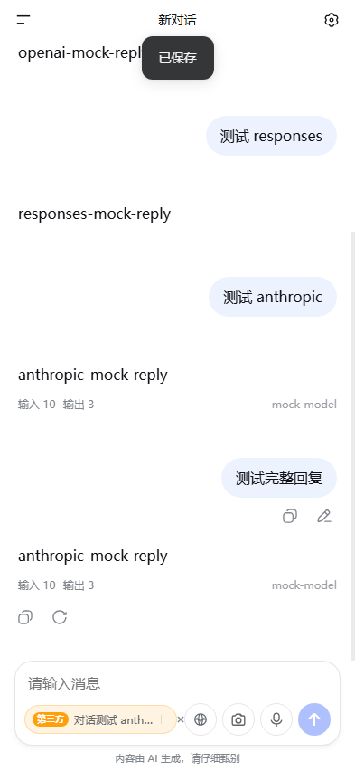

# DeepSeek 对话 · 红米适配版（第三方接口改写版）

一个基于 Android WebView 的 **DeepSeek 风格聊天助手**，自带多协议第三方 API 接入能力。
本仓库只提供已构建好的 APK，供学习研究使用。

> **适配说明：本 APK 按红米（Redmi）手机的屏幕尺寸（393 × 852 逻辑像素）做了界面适配，界面验证通过浏览器等宽模拟完成，尚未在红米真机上实测。**
> 其他品牌/机型可以安装，但软键盘、全面屏安全区、字体缩放等表现可能不同，不保证显示效果，出现问题也不代表可以修复。

- 应用名：DeepSeek 对话
- 包名：`com.deepseek.chatdemo`
- 版本：`1.0.9`（versionCode 9）· 2026-11-26
- 最低系统：Android 6.0（API 23），目标 API 35
- APK 大小：7,521,621 字节（约 7.2 MiB）· SHA-256 见下文
- 本仓库不是 DeepSeek 官方项目，与任何 AI 厂商均无隶属或授权关系

---

## 下载

| 文件 | 说明 |
| --- | --- |
| [`apk/DeepSeek-Chat-Demo-1.0.9-background-fixed.apk`](apk/DeepSeek-Chat-Demo-1.0.9-background-fixed.apk) | 当前版本安装包（1.0.9，切换应用断线恢复修复） |
| [Releases](https://github.com/xtx-hlzm/deepseek-chat-demo-redmi/releases) | 同一安装包的发布页下载入口（推荐） |

SHA-256（APK）：

```
B27E63433BDA682AEB3221B1D091F10CBF1F4F0DDD7F9948C68CCF63892FBD55
```

## 本次更新（1.0.9）

修复一个影响日常使用的问题：**回复还在思考 / 正在生成时切换屏幕（切到别的应用、锁屏、回到桌面）会被打断，并误报成「API 地址错误」或「协议选错」。**

- 网络中断、后台连接断开、数据被截断与真正的协议格式错误分开处理，不再把断网说成协议问题。
- 切到后台导致连接中断、且还没收到任何内容时，回到前台会**自动重发一次原请求**，站点、模型、协议、密钥都沿用原请求的配置。
- 已经收到部分内容时**不自动重发**，保留已收到的文字并提示「连接中断」，可手动重新生成。
- 回到前台后旧连接长时间无响应会主动结束，界面不会一直卡在「正在思考」。
- 收到流式完成标记立即结束，不再等中转站关闭长连接。
- 用户主动停止、密钥错误、真正的格式错误不会触发后台自动重试。
- 第三方站点可在「更多连接设置」里**关闭**「切换应用后的连接恢复」。

如果之前遇到「明明地址没错却提示地址错误」，升级到这个版本即可。

## 安装

1. 下载上面的 APK 到手机。
2. 在系统设置中允许「安装未知来源应用」（红米：设置 → 应用设置 → 授权管理 → 安装未知应用）。
3. 用文件管理器打开 APK 安装。
4. 若已安装旧的 1.0.5 ~ 1.0.8 修复版：签名相同，**可直接覆盖升级，会话与配置保留**。若装的是其他来源的同一个包名的应用，需要先卸载（会清除本地会话与配置）。
5. 首次启动后进入 设置 → 服务商与模型，填写自己的 API Key 或第三方网关信息。

> 安装过程中如果被「MIUI 优化 / 安全检测」拦截，属于系统对侧载 APK 的常规提示，请自行判断是否继续。

## 功能介绍

### 聊天主体

- DeepSeek 风格的对话界面：新建对话、会话列表、重命名、删除、清空全部对话。
- 流式输出，边生成边显示；支持中途停止生成、重新生成、编辑已发送消息。
- 「深度思考 / 推理强度」开关：可按低 / 中 / 高选择思考档位，并显示「正在思考」「已思考（用时 N 秒）」。
- Markdown 渲染、代码块、表格、Mermaid 图表（图表与代码可切换）、链接等常见内容展示。
- 消息复制、长按选中文本、错误分类提示（鉴权失败、模型不存在、限流、超时、网络不可达、协议不匹配等）。
- 图像搜索、智能搜索、按需联网的界面入口；实际是否可用取决于所接入的服务商与模型。

### 服务商与模型

- 「官方直连」与「自定义服务商」分组：官方站点的地址固定，只填 API Key；自定义站点可保存多条并随时切换。
- **四种 API 协议**：
  - OpenAI Chat Completions
  - OpenAI Responses
  - Anthropic Messages
  - Gemini API
- 每个站点可独立设置：站点名称、API 地址、API Key、模型清单、默认模型、推理强度。
- 获取可用模型：从接口读取模型目录并自动填充；接口不返回列表时可手动添加模型。
- 连通测试：实际调用所选模型，返回耗时；会产生少量真实费用。
- 高级连接设置：认证方式、思考参数格式、请求超时、最大输出 token、流式 / 完整回复、专用聊天与模型地址。
- API 地址兼容站点根地址、带版本地址、完整聊天地址，并保留中转网关的路径前缀。
- 模型名校验：当前服务商缺少所选模型时会阻止发送，避免无效请求。
- 切换应用后的连接恢复（1.0.9）：切到后台断线后回到前台自动续接 / 重发；可在「更多连接设置」中关闭。
- 配置只保存在本机（WebView 的 localStorage），不上传任何服务器。

### 附件与输入

- 上传文件：支持 PDF、DOC、XLSX、PPT、图片、文本、代码等；有单文件大小、文件数量与总占用空间限制。
- 图片：拍照 / 从相册选择，随消息发送。
- 语音输入：调用系统语音识别，失败或权限被拒时会提示（是否可用取决于机型与系统语音服务）。
- 全局软键盘适配：输入框获得焦点时把编辑区域抬到软键盘上方，这是本版本针对红米等窄屏机型重点调整的部分。

### 数据与统计

- 用量统计：按会话、按模型筛选，查看调用次数、输入/输出/缓存 Token、累计耗时、首字延迟，可清空记录。
- 导出 / 导入历史对话：导出为 ZIP（含对话与本地图片原件，不含 API Key）；可导入 DeepSeek 导出的历史对话 ZIP，导入会覆盖本地全部对话。
- 记忆便签：可保存多条「人设 / 输出要求」便签，开启后每次提问都会把当前便签作为规则注入，用于固定人设与输出格式。
- 其他：新对话、重命名、清空全部对话与统计记录。

### 隐私

- 会话、附件、API Key 均保存在本机应用沙箱内。
- 应用只与你填写的 API 地址通信；没有内置的统计上报或第三方追踪服务。
- 导出文件不包含 API Key；但本地备份文件、截图仍可能包含敏感内容，请自行保管。

## 界面截图



> 截图为按手机宽度模拟的界面，非红米真机拍摄。

## 已知限制

- 按红米手机宽度（393 × 852 逻辑像素）做过界面验证，**未在红米真机上实测，也未做全品牌兼容性测试**。
- 未使用真实第三方密钥做联网回归；不同站点、不同模型的参数限制、推理档位支持程度可能不同。
- 「推理强度」的实际效果取决于服务商与模型，部分模型只支持固定档位或不支持关闭思考。
- 联网搜索、语音识别等能力依赖所接入的服务与系统组件，可能显示入口但不可用。
- 开启后台自动重发时，一次提问可能产生两次 API 调用与费用。
- 系统强行终止整个应用进程时无法保证连接继续；重新打开后可查看已保存内容并重新生成。
- 应用使用自定义证书签名，无法与原版应用互相覆盖升级。

## 仓库内容

```
README.md   本说明
apk/        已构建的安装包
docs/       版本更新说明（1.0.8、1.0.9）
screenshots/ 第三方接口设置界面截图（浏览器尺寸模拟，非真机拍摄）
```

本仓库不包含源码。应用内嵌的前端资源为构建产物。

本 APK 是面向个人使用的修改 / 重打包版本（重新签名并补充第三方接口配置模块），不是任何官方渠道发布的安装包。

## 更新记录

| 版本 | 日期 | 主要变化 |
| --- | --- | --- |
| 1.0.9 | 2026-11-26 | 修复切屏 / 后台断线被打断并误报「地址错误」；无输出时回前台自动重发一次，有输出时保留内容；失效连接自动结束。详见 [`docs/CHANGELOG-1.0.9.txt`](docs/CHANGELOG-1.0.9.txt) |
| 1.0.8 | 2026-11-25 | 第三方站接入重写：独立配置存储、协议请求与设置界面；四协议；每站点独立模型与推理档位。详见 [`docs/CHANGELOG-1.0.8.txt`](docs/CHANGELOG-1.0.8.txt) |

---

# Disclaimer 免责声明

This project is for learning and research purposes only, provided on an "AS IS" basis without any warranty.
本项目仅供学习研究，按现状提供，不提供任何担保。

Users shall bear all risks arising from usage, including API charges, account ban, copyright infringement, data loss and other losses. The authors are not liable for any damages.
使用者自行承担全部使用风险，包括API扣费、账号封禁、版权侵权、数据丢失等损失，作者不承担赔偿责任。

It is the user's responsibility to comply with local laws and third-party platform terms. Any illegal or infringing use is solely the user's responsibility.
使用者应当遵守当地法律以及第三方平台协议，任何违规、侵权使用的责任由使用者自行承担。

This project is not officially affiliated with any AI model provider.
本项目不属于任何AI厂商官方项目，无官方授权。
